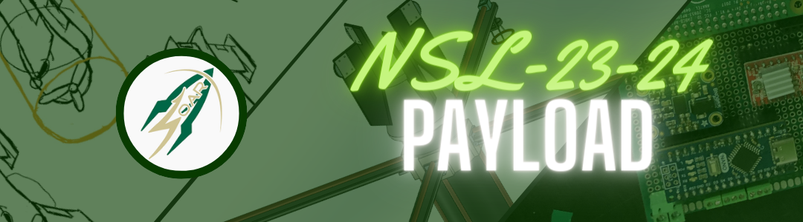
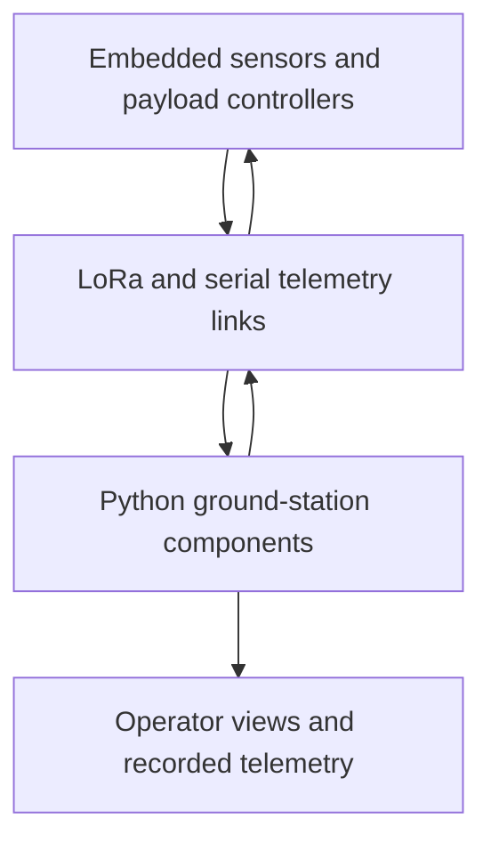

# Flight Telemetry & Payload Control

**Embedded firmware, telemetry, and ground-station software from USF's Society of Aeronautics and Rocketry NASA Student Launch work.**

The system collects flight and payload sensor data, coordinates deployment-related hardware, and sends telemetry to operators on the ground for monitoring and recovery. This repository brings together microcontroller firmware, Python ground-station components, recorded data, and electronics designs from the team's 2023–2024 work.

**Stack:** Embedded C/C++ · Python · Flask / Socket.IO components · LoRa · Serial / I²C · ESP32 / Teensy · Sensors · SD logging · PCB design

[My contributions](#my-contributions--omar-khalaf) · [Code walkthrough](docs/engineering-overview.md) · [System design](Media/Payload_design_v5.png) · [Schematics](Schematics)

## My contributions — Omar Khalaf

Within the EE/CS team, I led and contributed to the electronics/software integration work: telemetry and data acquisition, control-system integration, sensor and communication interfaces, PCB bring-up, and physical testing for flight readiness. I helped connect the embedded modules to the ground-monitoring workflow and coordinate the work across the wider payload effort.

This is a **collaborative team repository**. Firmware, ground-station software, schematics, and media reflect the combined efforts of USF SOAR members. My leadership and integration contributions do not imply sole authorship of every file or subsystem. I also served as SOAR Chief of Operations; this repository focuses on the technical work behind that broader role.

## What the system does

- Reads motion, altitude, and GPS data through the embedded sensor modules.
- Records flight/payload data to SD storage and transmits telemetry through the communication modules.
- Implements deployment-related state/control logic and hardware interfaces.
- Provides ground-station components for decoding incoming messages, viewing status, and issuing operator commands.
- Documents the electronics and communication architecture with schematics, PCB fabrication files, and system diagrams.

This diagram summarizes the intended system boundaries. The [team's detailed design diagram](Media/Payload_design_v5.png) shows the payload, deployment, recovery, ground-computer, and video paths; it includes design context beyond what is present as runnable software in this archive.

## Explore the software

| Component | Start here | What to look for |
| --- | --- | --- |
| Deployment module | [`deploy_module/deploy_module.ino`](deploy_module/deploy_module.ino) | Deployment state/control logic, motor/distance/altitude interfaces, BLE and LoRa integration |
| Drone/payload controller | [`drone_master/drone_master.ino`](drone_master/drone_master.ino) | Sensor acquisition, telemetry scheduling, SD logging, and peripheral coordination |
| Rocket telemetry | [`slave_module_rocket/slave_module_rocket.ino`](slave_module_rocket/slave_module_rocket.ino) | GPS/IMU collection, radio messages, and flight data recording |
| Ground station | [`SOAR_Echo_Base/app.py`](SOAR_Echo_Base/app.py) and [`control_panel.py`](SOAR_Echo_Base/Controllers/control_panel.py) | Serial-message handling, decoding, status events, and operator-command routing |
| Hardware design | [`Schematics/`](Schematics) | Module schematics, PCB Gerbers, and architecture drawings |

For a guided review of the data path, engineering tradeoffs, and archive limitations, see the [engineering overview](docs/engineering-overview.md).

## Project evidence

- [Payload/recovery/ground-station architecture](Media/Payload_design_v5.png)
- [Avionics schematic](Schematics/Schematic_Avionics-Module_2024-03-03.png)
- [Deployment schematic](Schematics/Schematic_Deployment-Module_2024-03-03.png)
- [Drone module schematic](Schematics/Schematic_Drone-Module_2024-03-03.png)
- [Drone data sample](drone_master/Drone_data.csv) and [rocket IMU data](slave_module_rocket/imu_data.csv)

## Running and validation

This is a historical hardware-project archive rather than a packaged, hardware-independent application. The work involved physical bring-up and integration testing; the repository does not include a complete automated verification suite or a reproducible build for every subsystem.

Embedded programs require their original board selections, peripherals, wiring, and library versions. The ground-station snapshot references supporting modules/assets that are not all included, so `app.py` is not presented as a complete clone-and-run demo. See [reproduction notes](docs/engineering-overview.md#reproduction-notes) for the specific boundaries before attempting a build or hardware run.
